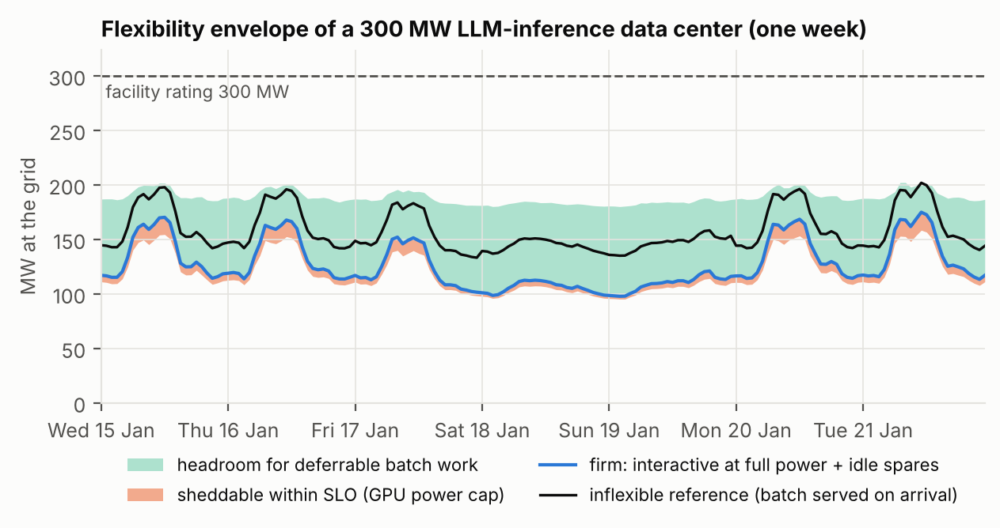

# flexible-ai-datacenter

**How flexible must an AI data center be?** We study SLO-grounded flexibility of LLM inference
fleets, its value under network-constrained optimal power flow, and feasibility-guaranteed
learned dispatch.

- **Fleet → envelope.** Turn LLM-serving SLOs (TTFT, TPOT, batch deadlines) into linear
  hourly flexibility envelopes: power floor and ceiling, ramp limits, deferrable energy.
- **Grid value.** Run multi-period DC-OPF on RTS-GMLC and IEEE-118 with renewables. Compare
  inflexible, price-following, carbon-following and co-optimized data centers on cost,
  congestion, curtailment and *true* emissions.
- **Learned solver.** Use DC3-style, FSNet-style and gauge-map solvers with zero
  grid/SLO violations, benchmarked against HiGHS.
- **Headline.** Build a *flexible-interconnection map*: the minimum SLO-feasible flexibility
  an AI data center must offer to be hosted at each bus.

See **[PLAN.md](PLAN.md)**.

## Status
- **Phase 1 done (grid).** The RTS-GMLC loader, multi-period DC-OPF (PTDF + HiGHS),
  and LMPs/LMEs from the optimal basis are in place and tested.
- **Phase 2 done (fleet → envelope).** There is an SLO-aware replica simulator
  (chunked-prefill continuous batching, roofline timing, power-cap physics),
  driven by the 2024 Azure LLM inference trace. It produces hourly linear
  envelopes (firm / sheddable / deferrable) that the OPF consumes directly.
- Learned solvers and the experiments for phases 3–5 are next.

```bash
pip install -e '.[dev]'
python -m gridflex.datasets               # fetch RTS-GMLC (pinned commit) into data/raw/
pytest -q                                 # 19 tests
python experiments/p1_baseline_year.py    # full-year grid baseline -> results/p1/
python experiments/p2_envelope.py         # fleet tables, envelope, Fig. 2a-c -> results/p2/, paper/figures/
```

### Phase 1 baseline (RTS-GMLC 2020, no data center, 366 day-ahead OPFs)

| | nameplate ratings | ratings x0.6 (congested case) |
|---|---|---|
| Load | 37.7 TWh | 37.7 TWh |
| Generation cost | $449 M | $484 M |
| CO2 | 15.7 Mt (0.417 t/MWh) | 16.8 Mt (0.446 t/MWh) |
| Renewable curtailment | 0.73 TWh | 2.06 TWh |
| Congestion rent | $31 M | $105 M |
| Binding line-hours | 4,114 | 22,328 |
| Mean LME / mean LME spread across buses | 0.71 / 0.38 t/MWh | 0.72 / 1.07 t/MWh |
| Wall time (laptop CPU) | 77 s | 97 s |

Takeaways for later phases:
- The *marginal* emission rate (about 0.71 t/MWh) is far above the *average*
  (about 0.42). Coal is cheaper than gas combined cycle here, so price-following
  load tends to land on coal. This is the mechanism behind the Knittel effect.
- At nameplate ratings RTS-GMLC is only lightly congested. Congestion studies
  use lines derated to 0.6x and always report the scale.
- Each 24 h OPF takes about 0.25 s in HiGHS, so a learned solver has to justify
  itself on scenario-scale sweeps (RQ5), not on single solves.

## Layout
```
src/gridflex/
  fleet.py       # SLO-aware LLM inference fleet simulator
  envelope.py    # fleet -> hourly flexibility polytope
  grid.py        # RTS-GMLC / IEEE-118 loaders, renewables, emission rates
  opf.py         # multi-period DC-OPF (PTDF) with DC envelopes, HiGHS
  modes.py       # inflexible / price- / carbon-following / co-optimized
  emissions.py   # true emissions + locational marginal emissions
  solvers/       # DC3, FSNet-style, gauge-map learned solvers
experiments/     # one script per RQ -> results/*.csv + paper/figures
data/raw/        # download scripts only (data not committed)
paper/           # claims, figures, related work -> paper-orchestra
```

### Phase 2 envelope (300 MW LLM-inference facility, default config)

| | |
|---|---|
| Servers (8xH100, 70B-class, TP8) | 30,864 |
| Mean / peak draw | 157 MW / 202 MW (load factor 0.52) |
| Sheddable within SLO (power capping) | 7.7 MW mean, **4.9% of load** |
| Deferrable batch energy (24 h deadline) | **19.8% of energy**; 62 MW mean headroom |
| Batch energy efficiency | 4.6 J/token at a 50% power cap (vs 6.0 J/token uncapped) |



Takeaways:
- **Interactive serving offers little flexibility.** Under a p99 SLO of
  TTFT 1 s / TPOT 100 ms, replicas provisioned at 80% of capacity can only be
  capped to about 70% of TDP. Below that, SLO capacity collapses (Fig. 2a). That
  leaves about 5% of load sheddable, rising to about 10% if the SLO is loosened
  2x (Fig. 2c).
- **Real flexibility depends on how much deferrable batch work there is.**
  The shiftable share grows linearly with batch fill (Fig. 2c). Headline claims
  like "25% flexible" really assume a batch share this large.
- **Capping is more efficient for batch work.** 50% of TDP gives the lowest
  J/token. Deferring batch work therefore also cuts its energy compared with
  running it uncapped.
