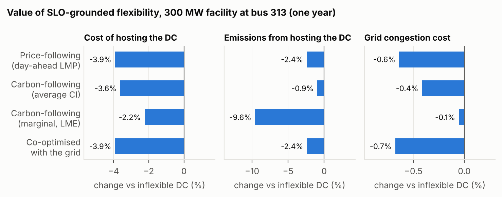
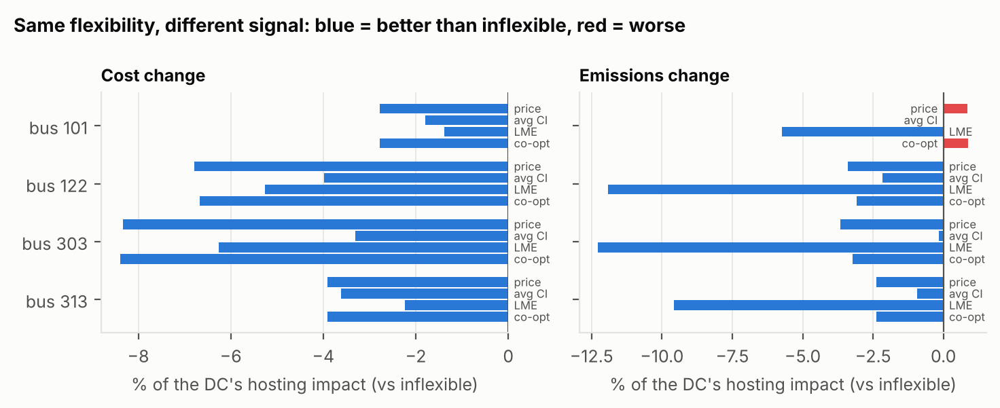
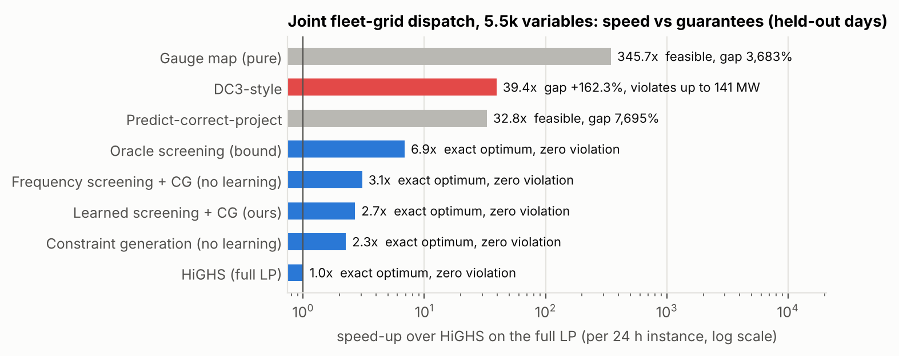
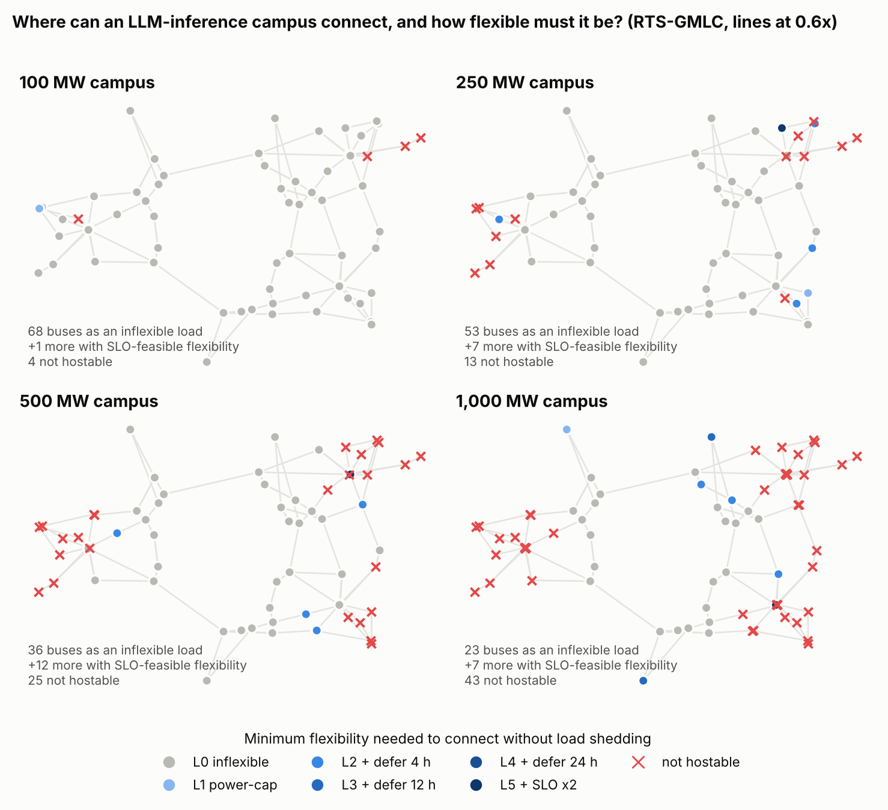

# flexible-ai-datacenter

**How flexible must an AI data center be?** We study SLO-grounded flexibility of LLM inference
fleets, its value under network-constrained optimal power flow, and feasibility-guaranteed
learned dispatch.

- **Fleet → envelope.** Turn LLM-serving SLOs (TTFT, TPOT, batch deadlines) into linear
  hourly flexibility envelopes: power floor and ceiling, ramp limits, deferrable energy.
- **Grid value.** Run multi-period DC-OPF on RTS-GMLC and IEEE-118 with renewables. Compare
  inflexible, price-following, carbon-following and co-optimized data centers on cost,
  congestion, curtailment and *true* emissions.
- **Learned solver.** Use DC3-style, FSNet-style and gauge-map solvers with zero
  grid/SLO violations, benchmarked against HiGHS.
- **Headline.** Build a *flexible-interconnection map*: the minimum SLO-feasible flexibility
  an AI data center must offer to be hosted at each bus.

See **[PLAN.md](PLAN.md)**.

## Status
- **Phase 1 done (grid).** The RTS-GMLC loader, multi-period DC-OPF (PTDF + HiGHS),
  and LMPs/LMEs from the optimal basis are in place and tested.
- **Phase 2 done (fleet → envelope).** There is an SLO-aware replica simulator
  (chunked-prefill continuous batching, roofline timing, power-cap physics),
  driven by the 2024 Azure LLM inference trace. It produces hourly linear
  envelopes (firm / sheddable / deferrable) that the OPF consumes directly.
- **Phase 3 done (grid value).** One year, 5 sites, 6 operating modes, a
  48 h-lookahead rolling horizon, and copper-plate replays for congestion cost.
  See the results below and [`paper/claims.md`](paper/claims.md).
- **Phase 4 done (solvers), with a mostly negative result.** See below:
  hard-constraint learning struggles on this problem, and the reason is
  structural.
- **Phase 5 done (Figure 1).** The flexible-interconnection map for all
  73 buses x 4 campus sizes, every point exact, flexible entries verified
  over the full year.
- **Phase 6 done: the paper.** [`paper/paper.pdf`](paper/paper.pdf) (ICLR 2025 format) was produced with Google's
  PaperOrchestra pipeline from `paper/raw_materials/`, with every number generated from `results/` and every
  reference API-verified. See [`paper/orchestra_run/README.md`](paper/orchestra_run/README.md).

```bash
pip install -e '.[dev]'
python -m gridflex.datasets               # fetch RTS-GMLC (pinned commit) into data/raw/
pytest -q                                 # 19 tests
python experiments/p1_baseline_year.py    # full-year grid baseline -> results/p1/
python experiments/p2_envelope.py         # fleet tables, envelope, Fig. 2a-c -> results/p2/, paper/figures/
python experiments/p3_value.py            # 61 year-long runs, 4 workers, ~45 min -> results/p3/
python experiments/p3_analyze.py          # deltas, X%/Y%, Fig. 3-4
python experiments/p4_solver.py           # ~1.5k HiGHS-labelled instances, 3 learned solvers + screening, Fig. 5 (~35 min)
python experiments/p5_map.py              # stage 1: 73 buses x 4 sizes on 48 stress days (~11 min)
python experiments/p5_map.py --verify     # stage 2: full-year verification of flexible entries, Fig. 1 (~25 min)
python experiments/p5_map.py --validate   # full-year spot checks at the phase 3 sites
```

### Phase 1 baseline (RTS-GMLC 2020, no data center, 366 day-ahead OPFs)

| | nameplate ratings | ratings x0.6 (congested case) |
|---|---|---|
| Load | 37.7 TWh | 37.7 TWh |
| Generation cost | $449 M | $484 M |
| CO2 | 15.7 Mt (0.417 t/MWh) | 16.8 Mt (0.446 t/MWh) |
| Renewable curtailment | 0.73 TWh | 2.06 TWh |
| Congestion rent | $31 M | $105 M |
| Binding line-hours | 4,114 | 22,328 |
| Mean LME / mean LME spread across buses | 0.71 / 0.38 t/MWh | 0.72 / 1.07 t/MWh |
| Wall time (laptop CPU) | 77 s | 97 s |

Takeaways for later phases:
- The *marginal* emission rate (about 0.71 t/MWh) is far above the *average*
  (about 0.42). Coal is cheaper than gas combined cycle here, so price-following
  load tends to land on coal. This is the mechanism behind the Knittel effect.
- At nameplate ratings RTS-GMLC is only lightly congested. Congestion studies
  use lines derated to 0.6x and always report the scale.
- Each 24 h OPF takes about 0.25 s in HiGHS, so a learned solver has to justify
  itself on scenario-scale sweeps (RQ5), not on single solves.

## Layout
```
src/gridflex/
  fleet.py       # SLO-aware LLM inference fleet simulator
  envelope.py    # fleet -> hourly flexibility polytope
  grid.py        # RTS-GMLC / IEEE-118 loaders, renewables, emission rates
  opf.py         # multi-period DC-OPF (PTDF) with DC envelopes, HiGHS
  modes.py       # inflexible / price- / carbon-following / co-optimized
  emissions.py   # true emissions + locational marginal emissions
  solvers/       # DC3, FSNet-style, gauge-map learned solvers
experiments/     # one script per RQ -> results/*.csv + paper/figures
data/raw/        # download scripts only (data not committed)
paper/           # claims, figures, related work -> paper-orchestra
```

### Phase 2 envelope (300 MW LLM-inference facility, default config)

| | |
|---|---|
| Servers (8xH100, 70B-class, TP8) | 30,864 |
| Mean / peak draw | 157 MW / 202 MW (load factor 0.52) |
| Sheddable within SLO (power capping) | 7.7 MW mean, **4.9% of load** |
| Deferrable batch energy (24 h deadline) | **19.8% of energy**; 62 MW mean headroom |
| Batch energy efficiency | 4.6 J/token at a 50% power cap (vs 6.0 J/token uncapped) |


Takeaways:
- **Interactive serving offers little flexibility.** Under a p99 SLO of
  TTFT 1 s / TPOT 100 ms, replicas provisioned at 80% of capacity can only be
  capped to about 70% of TDP. Below that, SLO capacity collapses (Fig. 2a). That
  leaves about 5% of load sheddable, rising to about 10% if the SLO is loosened
  2x (Fig. 2c).
- **Real flexibility depends on how much deferrable batch work there is.**
  The shiftable share grows linearly with batch fill (Fig. 2c). Headline claims
  like "25% flexible" really assume a batch share this large.
- **Capping is more efficient for batch work.** 50% of TDP gives the lowest
  J/token. Deferring batch work therefore also cuts its energy compared with
  running it uncapped.

### Phase 3: grid value of the envelope (RTS-GMLC, lines at 0.6x, 300 MW facility, one year)

Each row compares a flexible mode with an inflexible facility at the same bus.
Values are % of the facility's *hosting impact* (what the inflexible DC adds
over no DC). The facility uses the same envelope throughout (shed 1.5% of
energy, shift 20%); only the signal it follows changes.

| Bus (area) | Hosting CO2 intensity | Co-opt: cost | Co-opt: CO2 | LME-following: cost | LME-following: CO2 | Avg-CI-following: CO2 |
|---|---|---|---|---|---|---|
| 101 (1, coal-heavy) | 0.81 t/MWh | −2.8% | **+0.9%** | −1.4% | −5.7% | 0.0% |
| 122 (1, wind) | 0.52 t/MWh | −6.7% | −3.1% | −5.3% | −11.9% | −2.2% |
| 303 (3, wind pocket) | 0.48 t/MWh | −8.4% | −3.2% | −6.3% | −12.3% | −0.2% |
| 313 (3, load centre) | 0.57 t/MWh | −3.9% | −2.4% | −2.2% | −9.6% | −0.9% |




Findings:
1. **The value of SLO-feasible flexibility is real but modest.** It cuts
   hosting cost by 3–8% and grid congestion cost by up to 3.8% (bus 303). Of
   the 3.9% saved at bus 313, about half comes from shifting batch work and half
   from power capping. Capping's emissions benefit is almost entirely the energy
   it saves (20.5 GWh).
2. **The signal matters more than the flexibility.** With the same envelope,
   following locational marginal emissions cuts hosting emissions by 6–12%,
   3–4x more than cost-optimal co-optimisation, while keeping 50–80% of the
   cost savings. Following the *average* carbon intensity, the default in
   carbon-aware schedulers, does almost nothing for emissions (0 to −2%). At
   bus 313 with shift only, it *raises* them (+0.5%).
3. **The Knittel effect appears where coal sits at the margin.** At bus 101,
   price-following and co-optimisation cut cost 2.8% but raise emissions 0.9%.
   A single 300 MW facility is a price-taker here, so price-following and
   co-optimisation land on almost the same outcome.
4. **A carbon price aligns the signals.** On a grid priced at $50/t,
   price-following, LME-following and co-optimisation all converge
   (−22.3 to −22.5 kt CO2/yr at bus 313).
5. **Location dominates operation.** The same facility's hosting CO2 intensity
   ranges from 0.48 to 0.81 t/MWh across buses, much larger than any operating
   mode's effect. At the radial bus 207 the facility is **not hostable**
   (156 GWh/yr of involuntary load shedding). Co-optimisation cuts that
   shedding by 36%, but network-blind carbon signals *increase* it by 38–43%.
   This motivates the phase 5 flexible-interconnection map.

### Phase 4: can a constraint-enforcing learned solver beat HiGHS here?

The family is the 24 h fleet-grid DC-OPF at bus 313 (5.5k variables; HiGHS
takes ~0.25 s). It is trained on 1,168 HiGHS-labelled day x envelope instances
and tested on 296 held-out days plus 74 out-of-distribution instances
(a 600 MW facility).



| Method (held-out days) | Speed-up | Optimality gap | Max violation |
|---|---|---|---|
| Oracle line screening (bound) | 6.9x | 0 | 0 |
| **Frequency screening + constraint generation (no learning)** | **3.2x** | **0** | **0** |
| Learned screening + constraint generation | 2.6x | 0 | 0 |
| Constraint generation alone | 2.2x | 0 | 0 |
| DC3-style (completion + correction) | 21x | +211% | 178 MW |
| Predict-correct-project (DC3 + exact ray projection) | 34x | +11,268% | 0 |
| Pure gauge map around an interior anchor | 306x | +2,566% | 0 |

What we learned:
1. **Exact methods win.** Screening line limits and then generating
   constraints is optimal and feasible *by construction*, at 2–7x. A
   binding-frequency heuristic (3.2x) beats our learned screen (2.6x), whose
   recall drops to 77% on unseen days. The union of the two adds nothing.
2. **End-to-end constraint enforcement hits a structural wall.** Equalities are
   easy (completion by a *distributed slack*; a single-pivot completion piles
   all prediction error onto one bus and fails). But every strictly interior
   point of this LP must shed load at every bus, which is the only slack. So
   any feasibility restoration that retracts toward an interior point (gauge
   map, ray projection) is billed at the value of lost load. Feasible-by-construction
   outputs land 2,566–11,268% above the optimal cost. DC3-style correction stays
   cheap but violates line limits by up to 178 MW. FSNet-style L-BFGS
   feasibility seeking stalls at 13–40 MW and is no faster than HiGHS.
3. **The open problem this exposes:** *learning low-cost interior anchors*
   (or anchor-free certificates) for OPF families with VOLL slack. Without
   one, gauge and homeomorphic-projection guarantees are not useful at
   operational scale. That is a concrete question for the Donti group.

### Phase 5: the flexible-interconnection map (Figure 1)

*Where can an LLM-inference campus connect without upgrades, and how flexible
must it be?* For every bus and campus size we find the lowest rung of an
SLO-feasible ladder at which the grid serves the campus with **no involuntary
load shedding and no missed batch deadline**. The ladder is: L0 inflexible ->
L1 power-capping within the SLO -> L2/L3/L4 batch deferral of 4/12/24 h ->
L5 capping down to a 2x-relaxed SLO. Every rung has the same fleet, traffic
and energy.



| Campus | Hostable as an inflexible load | Hostable with SLO-feasible flexibility | Not hostable |
|---|---|---|---|
| 100 MW | 68 buses | 69 | 4 |
| 250 MW | 53 | 60 (+13%) | 13 |
| 500 MW | 36 | **48 (+33%)** | 25 |
| 1,000 MW | 23 | 30 (+30%) | 43 |

Summing the largest hostable campus at each bus (one campus at a time), SLO-grounded flexibility raises
hosting capacity from **35.3 GW to 42.9 GW (+22%)**.

Method and honesty notes:
- **Two stages, both exact.** Stage 1 runs exact screened HiGHS on 48 stress
  days per year (4 per month, 48 h windows). It gives exact "not hostable"
  answers and an exact lower bound: the level below fails on a real day.
  Stage 2 re-checks every flexible entry over all 365 days and raises it until
  every day passes.
- **Why stage 2 is needed.** Stress days chosen from *system* load missed
  *local* stress. Stage 2 raised 10 of 30 flexible entries, 3 of them to
  "not hostable". Doubling the stress days (2 to 4 per month) changed only 1
  of 292 entries, so more days was not the fix.
- **L0 entries are spot-checked, not exhaustively verified.** 9 of 9 sampled
  L0 answers held on all 365 days.
- **Short deferral does most of the work.** No site needs L4 (24 h deferral)
  as its minimum: where 12 h is not enough, 24 h is not either.
